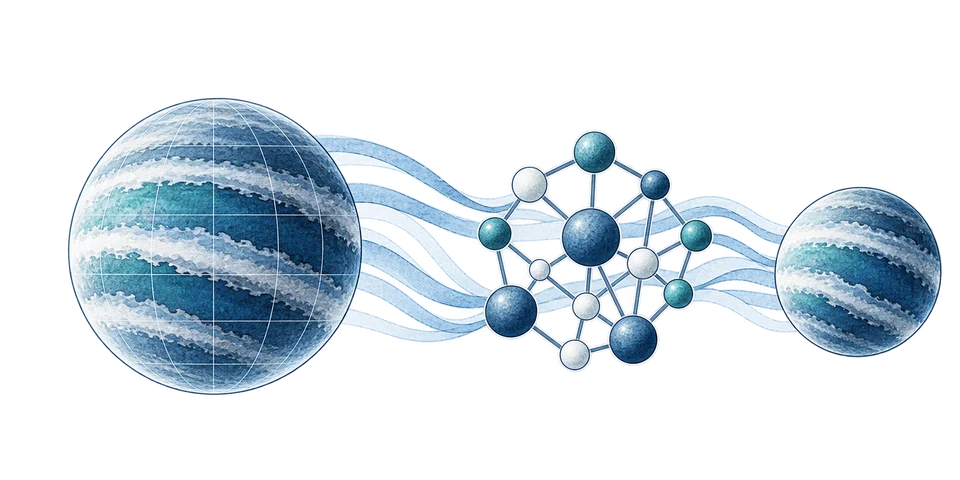

# C — Ink and pale wash

Website illustration and icon pack for Gordon Yip. Prepared 31 October 2026.

## Contents

- `originals/`: five full-resolution PNG illustrations generated using the built-in image-generation tool, based on the selected C reference.
- `web/`: ten optimized WebP files: a regular and smaller version of every illustration. The three research illustrations preserve transparency.
- `icons/`: three hand-coded SVG icons (planet, network, inspection), each with a light- and dark-background version.
- `asset-sizes.json`: actual pixel dimensions and file sizes.
- `generation-prompts.json`: the complete generation prompts for reproducibility.

## Colour direction

Light background #F6F9FC; surface #EAF0F6; navy #0F1A2C; slate #2C3E55; blue #15548A; teal #0E6B82. Dark icons use pale ink and a derived pale teal #8CC9D5 for visibility. Watercolour pigments contain tonal variations; use exact CSS palette values for interface text, controls and icons. The decorative images are not scientific diagrams or accessibility contrast guarantees.

## Placement

Use `hero-light.webp` behind the homepage introduction in light mode and `hero-dark.webp` in dark mode. These contain no text. The left side is kept quiet for the introduction; the planet occupies the right. Keep the text as HTML. At narrow widths, reduce the artwork opacity or hide it when it competes with the text. Match the site's existing theme state; do not add an independent theme system.

Use `research-retrieval.webp` for atmospheric retrieval and Bayesian inference, `research-surrogates.webp` for planetary chemistry and atmosphere models, and `research-interpretability.webp` for interpreting and testing scientific AI. The last illustration intentionally uses a non-astronomical ML motif. Display them about 240–360 CSS pixels wide, preserving their full aspect ratio with `object-fit: contain`. Their details will be lost in the old 72px icon slots.

Example after copying this pack into `assets/img/ink-wash-c/`:

```html

```

An empty alt attribute is appropriate when adjacent text fully explains a decorative illustration. Give the image meaningful alt text if it conveys information beyond that text.

## SVG icons

Choose the file with the appropriate light/dark suffix. Suggested sizes: 24–32px for interface use and 48–64px for section markers. Use the planet for retrieval, network for surrogate modelling, and inspection icon for interpretability. Functional controls still need accessible labels.

When SVG markup is inlined, override `--icon-ink`, `--icon-accent`, and `--icon-fill` in CSS. SVGs loaded through an img element use their own fallback colours; page CSS variables will not automatically cross that boundary.

## Before publishing

Check the actual text over both backdrops, phone cropping, all three illustrations at their intended display widths, and icons on both themes. The illustrations and their alpha compositing were visually reviewed on cool-white and navy backgrounds; this pack has not been integrated into or browser-tested on the website. Website source files have not been changed.
